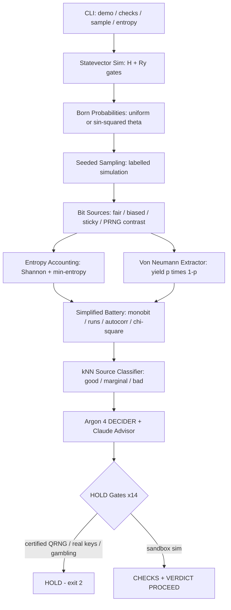
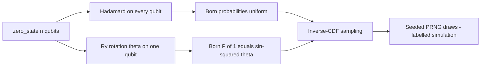
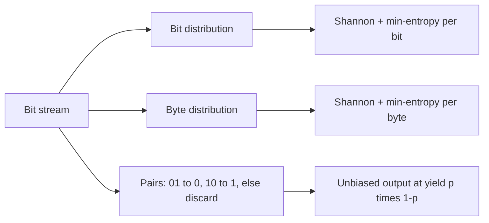
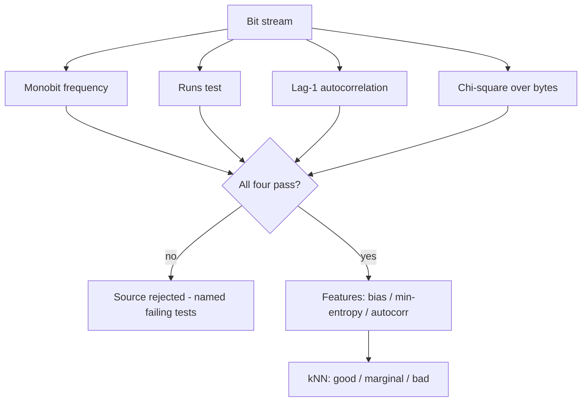
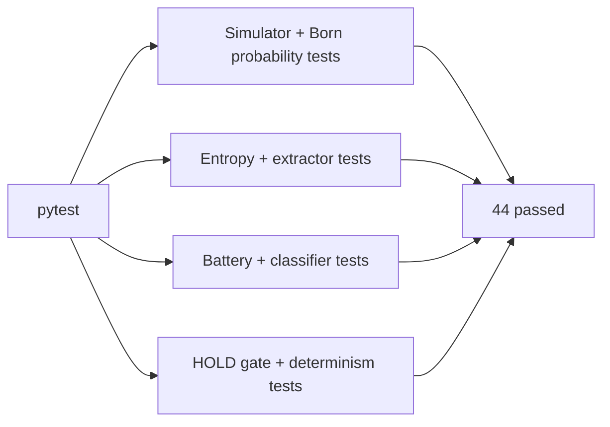
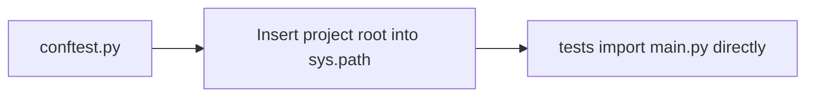
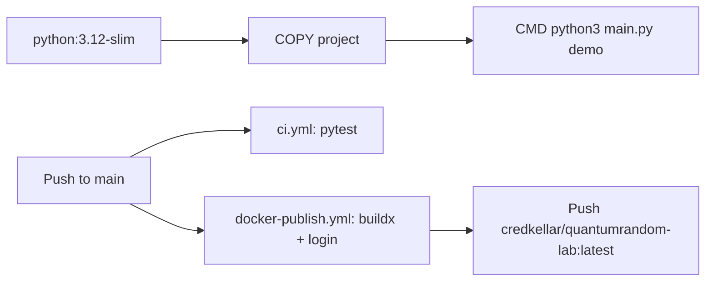

# QuantumRandom-Lab 🎲⚛️

**Quantum Randomness (QRNG) Lab** — by Darion Kellar

QuantumRandom-Lab is an **educational quantum randomness lab** in ONE pure-Python file. It starts from the one-sentence idea behind every QRNG — *put a qubit into (|0⟩ + |1⟩)/√2, measure it, and let nature pick the outcome* — and then refuses to let that idea be oversold:

- **The physics is real:** a from-scratch statevector simulator (≤ 6 qubits, pure-Python complex amplitudes) computes the Born probabilities itself — Hadamards on n qubits give a provably uniform distribution, and a qubit rotated by θ ≠ π/4 is a provably biased source with P(1) = sin²θ. 🔬
- **The sampling is labelled:** this lab's draws are driven by a **seeded classical PRNG** so the demo is deterministic — which means the output is, by construction, **not true quantum randomness**. The seed (20261117) is printed in every report. Real quantum randomness is not seeded; anyone selling seeded output as "quantum random" is selling you a HOLD gate. 🏷️
- **The statistics are honest:** Shannon entropy and min-entropy are accounted per bit and per byte, the von Neumann extractor removes bias at its theoretical yield p(1−p), and a **simplified** NIST-style battery (labelled simplified — not the real SP 800-22 suite) fails the biased raw stream and passes it after extraction — while the classical PRNG contrast stream passes too, proving that passing tests never certifies quantumness. 📊

Honest scope, stated up front: this lab operates **nothing real** — no QRNG device, no quantum hardware, no beacon. Its bits must never key anything real, seed any real password, or settle any real bet. Every certified-QRNG / real-key / gambling / beacon claim sits behind a permanent HOLD gate (14 total). 🔒

[](https://github.com/kimanicollier44-cmyk/QuantumRandom-Lab/actions/workflows/ci.yml)
[](https://github.com/kimanicollier44-cmyk/QuantumRandom-Lab/actions/workflows/docker-publish.yml)

> ℹ️ These are the **live** workflow badges for this repo. They activate as soon as the `ci.yml` and `docker-publish.yml` files from the paste pack are pasted into `.github/workflows/` — until then they have nothing to report yet.

## 🧰 Tech Stack Badges & Full Architecture Tech Stack

### 💻 Core Programming Languages & Core Systems


- 🐍 Python 3.12, pure standard library (`math`, `random`, `hashlib`, `json`, `sys`) — zero dependencies, zero network, deterministic (double-run byte-identical)
- ⚛️ Statevector core: ≤ 6 qubits as pure-Python complex amplitudes, gates applied index-by-index; Born probabilities |amplitude|² asserted uniform after Hadamards and sin²θ for the rotated qubit
- 🎲 Sources: Hadamard register sampling, rotated-qubit biased source, sticky (autocorrelated) source, and a classical PRNG contrast stream labelled NOT quantum
- 📊 Entropy + extraction + battery: Shannon / min-entropy accounting, von Neumann extractor (1951), simplified monobit / runs / lag-1 autocorrelation / chi-square battery with explicit thresholds
- 🧠 TinyML kNN source classifier (from scratch, stdlib): good / marginal / bad from (bias, min-entropy, |autocorrelation|), labels generated by the battery itself
- 🪑 Council seats: Gemini Argon 4 DECIDER (names-only, tighten-only) + Muse advisor (never overrides HOLD) + Google Flow plan-only (rendered = False, live = 0)

### ⛓️ Web3 & Infrastructure

- 🚫 **Not applicable — honestly.** No blockchain, no Web3, no tokens: the "infrastructure" in this lab is a labelled simulation of bit sources, an extractor, and a test battery inside one offline file. No fake badges here.

### ⚙️ Platform Support & Hardware Architecture


- 🖥️ Pure Python — runs anywhere Python 3.12+ runs (Linux, macOS, Windows), plus the `python:3.12-slim` Docker image
- 🔒 No hardware is controlled, ever: real QRNG devices, quantum hardware, and measurement apparatus are permanent HOLD gates (see the gate table below)

### ⚡ Low-Level Infrastructure & Performance

- 🚫 **No low-level code — honestly.** No C, no C++, no GPU, no compiled extensions: this is one interpreted Python file on purpose, so every probability, entropy figure, and test statistic can be read, checked, and diffed. Performance here means honest algorithms — inverse-CDF sampling against the Born distribution, exact entropy sums, and a chi-square over byte counts — all deterministic and byte-identical between runs.

### 🛠️ DevOps & Build Tools


- 🐳 Docker (`python:3.12-slim`), GitHub Actions CI + Docker Publish (delivered in the paste pack)
- 🎯 Target image: `credkellar/quantumrandom-lab:latest`
- 🧪 Tests: `pytest` (44 tests) + the built-in CHECKS suite (54 checks) in `main.py`

### ☁️ Cloud Providers

- 🚫 **None — honestly.** No cloud provider is used or needed: the lab runs fully offline on your own machine or in a local Docker container. Docker Hub appears only as the registry the publish workflow pushes the image to.

## What this does?

1. ⚛️ **Statevector simulator — the physics layer** — a register of ≤ 6 qubits held as pure-Python complex amplitudes; single-qubit gates (Hadamard, preparation rotation) are applied index-by-index, and Born probabilities |amplitude|² are computed from the state itself — never assumed.
2. 🪙 **The fair coin, proven** — Hadamards on 3 qubits give 8 basis states at exactly p = 0.1250 each, and every qubit's marginal P(1) = 0.5 — asserted to 1e-12 in CHECKS, then sampled 8,000 times to show the counts land where the physics says.
3. 🎚️ **The biased source, proven** — one qubit prepared as cos θ|0⟩ + sin θ|1⟩: θ = π/4 gives P(1) = 0.5000 (fair), θ = π/6 gives P(1) = 0.2500 exactly — the lab's heavily biased teaching source, with the bias read off the simulated state, not typed in.
4. 🏷️ **Seeded sampling, labelled** — all draws run against the Born probabilities through `random.Random(20261117)`. Same seed, same stream, byte-identical demo — and the lab says in every report why that makes it a simulation and not a QRNG.
5. 📊 **Entropy accounting** — Shannon entropy (average surprise) and min-entropy (worst-case surprise) per bit and per byte: the fair stream measures Shannon 1.0000/bit and 7.918/byte; the π/6-biased bit keeps 0.8113 bits of Shannon entropy but only **0.4150 bits of min-entropy** — the cautious number an attacker bets against.
6. ✂️ **Von Neumann extractor (1951)** — biased pairs 01 → 0, 10 → 1, 00/11 discarded: exactly unbiased output at a priced yield — 65,536 biased bits in, 12,105 bits out, measured yield **0.1847 bits per input bit** against the theoretical p(1−p) = **0.1875**, extracted P(1) = 0.5014. Extraction removes bias; it creates no new entropy.
7. 🧪 **Simplified test battery** — four teaching tests in the spirit of NIST SP 800-22 with explicit thresholds (monobit |s| < 2.576, runs |z| < 2.576, lag-1 autocorrelation < 2.576/√n, byte chi-square < 310.5 at df 255), labelled **simplified** everywhere they appear.
8. 🚨 **The battery bites** — the biased raw stream fails hard: monobit statistic **64.11** against a 2.576 threshold, byte chi-square **11,488** against 310.5. After von Neumann extraction the same source passes all four (chi-square 245.16). A sticky source (repeats its last bit 80% of the time) passes frequency but fails runs and autocorrelation (|r| = 0.5926) — bias and correlation are different diseases with different tests.
9. 🤖 **The contrast that teaches the limit** — a plain classical PRNG stream passes all four tests and is labelled `quantum_source = False` in the same report: passing statistics cannot prove a source is quantum, and this lab never claims otherwise.
10. 🏷️ **kNN source classifier + seats + checks** — a from-scratch kNN labels sources good / marginal / bad from (bias, min-entropy, |autocorrelation|) with labels generated by the battery itself (fair → good, P(1) = 0.47 → marginal, P(1) = 0.25 → bad, sticky → bad, extracted → good), with Argon 4 DECIDER (sha256 trace), Muse advisor, Google Flow plan-only, and a built-in CHECKS suite (54 checks).

## 🗺️ How it works — diagram per script

### `main.py` — the whole lab



### `main.py` § simulator + sampling — where the bits come from



### `main.py` § entropy + extractor — pricing the randomness



### `main.py` § battery + classifier — judging the source



### `tests/test_main.py` — verification



### `conftest.py` — test path setup



### `Dockerfile` + CI flow — container & publish



## Why is this cool?

1. ⚛️ The randomness starts from **actual amplitudes**: the simulator computes Born probabilities from a statevector it built gate by gate — the uniform distribution after Hadamards is derived, not hard-coded.
2. 🎚️ Bias is a **rotation angle**: one parameter θ turns the fair coin (π/4) into the 0.25-biased source (π/6), and the lab reads P(1) = sin²θ off the quantum state itself.
3. 🏷️ It is the rare randomness demo that **labels its own seed**: the determinism that makes the demo reproducible is stated in every report as the exact reason the output is *not* quantum randomness.
4. 📊 Min-entropy gets its moment: the biased bit's Shannon entropy (0.8113) looks respectable while its min-entropy (0.4150) tells the truth an attacker would use — both computed, both asserted.
5. ✂️ Von Neumann's 1951 extractor is shown **with its price tag**: 65,536 bits in, 12,105 out, measured yield 0.1847 against theory 0.1875 — unbiasedness is bought with throughput, and the receipt is printed.
6. 🚨 The battery's failure is **spectacular and specific**: monobit 64.11 vs a 2.576 line, chi-square 11,488 vs 310.5 — you don't just learn the biased source is bad, you see which tests catch it and by how much.
7. 🧲 The sticky source teaches the second disease: a stream can be perfectly unbiased and still be garbage — |autocorrelation| 0.5926 — and the runs/autocorrelation tests catch what the frequency test waves through.
8. 🤖 The PRNG contrast stream is the built-in humility check: it **passes everything** while wearing a NOT QUANTUM label, so the lab can never be misread as "tests passed ⇒ quantum".
9. 🏷️ The classifier's labels come from the battery itself — no hand-tuned verdicts: the same lines that fail streams in §5 decide what good / marginal / bad mean in §6.
10. 🎯 Deterministic end to end: run it twice, get byte-identical output — a randomness lab you can diff, which is exactly the paradox the honest labelling exists to explain.

## What problems this solves?

1. ❌ **Problem:** "Quantum random" gets claimed by demos that are classical PRNGs in a costume. ✅ **Solution:** The seed is printed in every report, `seeded_output_as_quantum_claim` is a permanent HOLD gate, and the PRNG contrast stream is labelled NOT quantum in the same table where it passes.
2. ❌ **Problem:** Randomness quality is usually asserted, not measured. ✅ **Solution:** Shannon and min-entropy are computed per bit and per byte for every stream, and the biased source's weak min-entropy (0.4150) is a checked number, not an adjective.
3. ❌ **Problem:** Biased sources get "fixed" by hand-waving (hash it and hope). ✅ **Solution:** The von Neumann extractor removes bias with a proof-shaped mechanism and an exact price — theoretical yield p(1−p) asserted against the measured 0.1847.
4. ❌ **Problem:** People think passing a randomness test certifies a source. ✅ **Solution:** The battery is labelled *simplified* everywhere, and the classical PRNG stream passing it — in the same report — is the standing counterexample.
5. ❌ **Problem:** Bias and correlation are confused for the same flaw. ✅ **Solution:** Two different teaching sources: the rotated qubit (biased, uncorrelated — fails monobit/chi-square) and the sticky source (unbiased, correlated — fails runs/autocorrelation).
6. ❌ **Problem:** QRNG explainers skip where the probabilities come from. ✅ **Solution:** A readable statevector simulator builds them from amplitudes, with uniformity and sin²θ asserted to 1e-12.
7. ❌ **Problem:** Entropy numbers get quoted without saying which entropy. ✅ **Solution:** Every report prints Shannon *and* min-entropy side by side, with the demo calling out why the min is the cautious one.
8. ❌ **Problem:** Extractor yield is rarely quantified, so "debiasing" sounds free. ✅ **Solution:** Pair acceptance 2p(1−p) and yield p(1−p) are formulas in the code, and the 65,536 → 12,105 bit receipt is in the demo.
9. ❌ **Problem:** Simulated bits drift toward real use (keys, passwords, draws). ✅ **Solution:** `cryptographic_key_generation`, `password_or_secret_generation`, and `gambling_lottery_claim` are permanent HOLD gates returning exit code 2.
10. ❌ **Problem:** Randomness tools quietly imply certification is next. ✅ **Solution:** 14 named HOLD gates — certified-QRNG claims, beacon operation, entropy guarantees, security certification — stay HOLD forever, and no advisory seat can override them.

## How to install this?

1. 📋 Clone or download this project folder:

```bash
git clone https://github.com/kimanicollier44-cmyk/QuantumRandom-Lab.git
```

2. 🐍 Make sure Python 3.12+ is installed: `python3 --version`
3. ▶️ Run the full demo + checks (no arguments needed):

```bash
python3 main.py
```

4. 🧪 Run the test suite:

```bash
pip install pytest
python3 -m pytest -q
```

5. 🎛️ Try the other commands:

```bash
python3 main.py checks    # 54 built-in checks
python3 main.py sample    # Born-distribution sampling report (seeded)
python3 main.py entropy   # Shannon + min-entropy per source
python3 main.py extract   # von Neumann yield: measured vs theory
python3 main.py tests     # simplified battery on all four streams
python3 main.py classify  # kNN source classifier report
python3 main.py brains    # Argon 4 + Muse + Flow seats
python3 main.py holds     # list all 14 HOLD gates
python3 main.py hold-demo # exits 2 - gated actions stay HOLD
```

6. 🐳 Or run it in Docker:

```bash
docker pull credkellar/quantumrandom-lab:latest
docker run --rm credkellar/quantumrandom-lab:latest
```

## Requirements

- 🐍 Python 3.12 or newer
- 📦 Dependencies: **none** (standard library only)
- 🌐 Network: **none** — fully offline
- 🧪 For tests only: `pytest`
- 🐳 Optional: Docker

## FULL project structure tree

```text
quantumrandom-lab/
├── main.py                  # the whole lab: statevector sim, bit sources, entropy, extractor, battery, classifier, seats, HOLD gates
├── conftest.py              # puts the project root on sys.path for tests
├── tests/
│   └── test_main.py         # 44 pytest tests: simulator, entropy, extractor, battery, classifier, gates, determinism
├── assets/
│   └── cover.png            # README cover image (2736 x 912)
├── .github/
│   └── workflows/
│       ├── ci.yml           # paste-in from the workflow pack
│       └── docker-publish.yml # paste-in from the workflow pack (tag: credkellar/quantumrandom-lab:latest)
├── Dockerfile               # python:3.12-slim, runs the demo
├── .gitignore               # __pycache__/, .pytest_cache/, *.pyc
└── README.md                # this file
```

> 📦 Delivered separately as paste packs (not in this tree): `.github/workflows/ci.yml` + `docker-publish.yml`, and the Docker Hub pack (100-char description, 350-char About, overview, categories).

## 🔒 HOLD gates — all 14, permanent

| # | Gate | What stays held |
|---|------|-----------------|
| 1 | `certified_qrng_claim` | No claim that this lab (or anything modelled in it) is a certified or standards-compliant QRNG |
| 2 | `cryptographic_key_generation` | No generating keys for real cryptographic use; simulated bits must never key anything real |
| 3 | `password_or_secret_generation` | No generating passwords, tokens, or secrets for real use |
| 4 | `gambling_lottery_claim` | No gambling or lottery claims — no predicting draws, no fairness certification for games of chance |
| 5 | `randomness_beacon_operation` | No operating a randomness beacon or supplying randomness as a service |
| 6 | `live_hardware_control` | No control of any real QRNG device, quantum hardware, or measurement apparatus |
| 7 | `entropy_guarantee_claim` | No guaranteed entropy claims for any real system; entropy here is measured on simulated streams only |
| 8 | `seeded_output_as_quantum_claim` | Seeded simulation output must never be presented as genuine quantum randomness |
| 9 | `clinical_trial_randomisation` | No randomisation for clinical trials or any medical use |
| 10 | `security_certification_claim` | No certifying any real RNG, product, or system as secure or truly random |
| 11 | `financial_trading_claim` | No financial or trading claims; simulated randomness is not a market signal |
| 12 | `scientific_result_claim` | Simulated streams are teaching data, not experimental results — never publish them as measurements |
| 13 | `weapons_application_claim` | No weapons application guidance of any kind |
| 14 | `investment_claim` | No investment advice about QRNG, quantum, or randomness companies |

🧑‍⚖️ **Council seats:** Gemini Argon 4 Extended Thinking — DECIDER (names-only, tighten-only, MAP → MODEL → STRESS → DECIDE, sha256 trace, `can_override_hold = False`) · Muse — advisor (`can_override_hold = False`) · Google Flow — plan-only (`rendered = False`, `live = 0`).

✅ **Verification:** pytest **44 passed** (project + clean copy) · built-in CHECKS **54/54** · double-run output **byte-identical** · `hold-demo` exits **2** · `main.py` **920 lines**, pure stdlib, zero network.

## 🧒 5th-grade English section

Imagine a coin that is **still spinning in the air** — it is not heads and not tails yet, it is a bit of both. When it lands, even nature did not know which side would come up. That is the idea behind a **quantum random number generator**: use tiny spinning quantum coins to make numbers nobody can predict — not even the person who built the machine. 🎲

- This lab lets you play with that idea on a computer. It builds the spinning coin out of math, checks that a fair quantum coin really lands heads half the time, and shows what happens when the coin is **tilted** so it lands tails too often. 🪙
- A tilted coin is a bad randomness machine, and the lab proves it with tests: count the heads (way too few!), group the bits into bytes (some bytes show up way too much!). Then it shows a clever 1951 trick — read the coin two flips at a time and keep only the mixed pairs — that **untilts** the output, but throws most of the flips away. Fairness costs flips! ✂️
- It also shows a **sticky coin** that likes to repeat itself. It lands heads half the time, so the first test says "fine!" — but the smarter tests catch it repeating. Two different ways to be bad, two different tests to catch them. 🧲
- And here is the honest part: the coins in this lab are **pretend**. A computer program flips them using a secret recipe with a starting number (a "seed"), and the lab prints that number right on the report. Real quantum coins have no recipe and no seed. So this lab teaches you how quantum randomness *works* — it does not make the real thing, and it will never let its pretend numbers be used as real keys, real passwords, or real lottery picks. 🔒

---

MIT © 2026 Darion Kellar · QuantumRandom-Lab — educational simulation only 🎲
